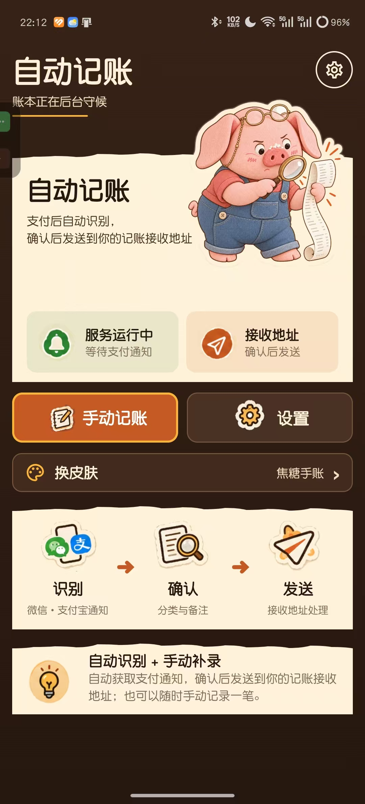
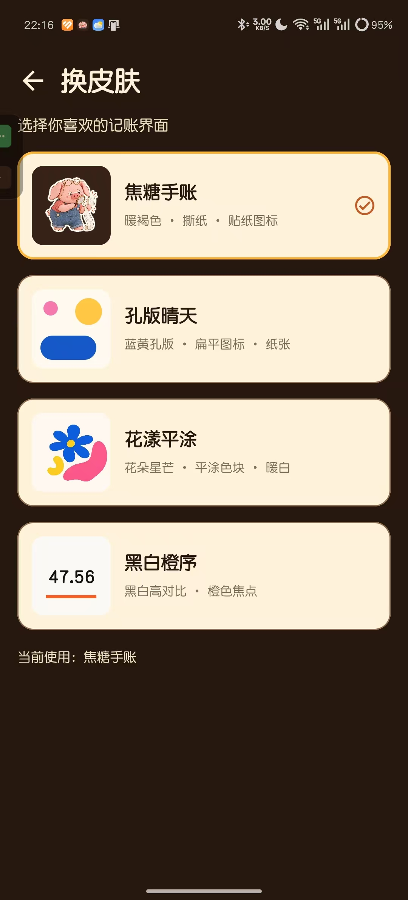
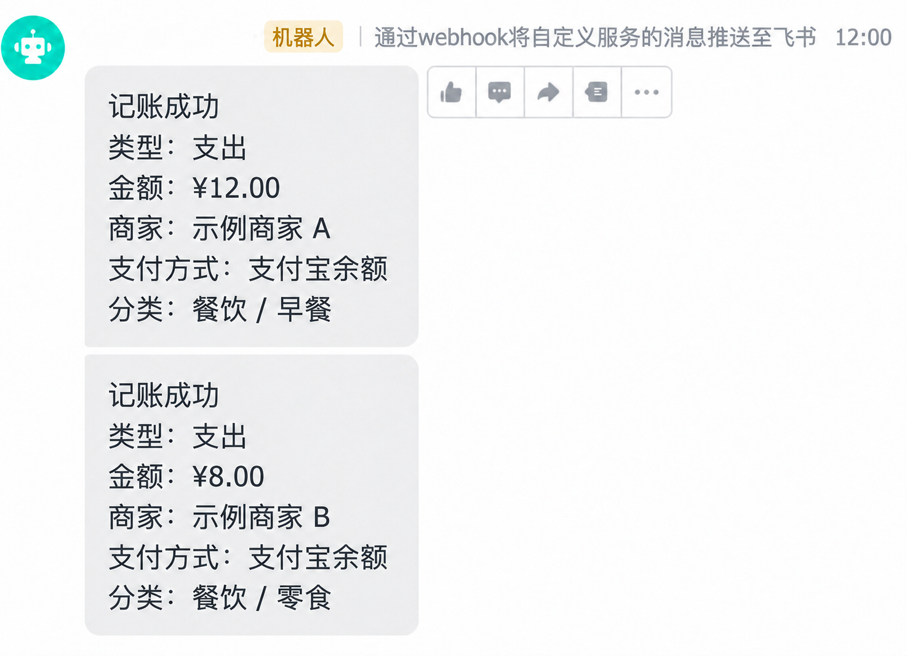
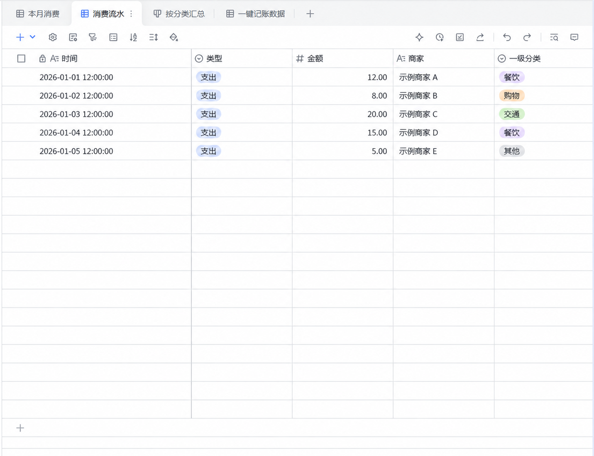

# AutoExpenseTracker · 自动记账

简体中文 | [English](README.en.md)

一款可自行安装使用的 Android 自动记账应用：识别微信、支付宝的支付相关通知，在手机上确认金额、类型和分类后，将记录发送到你自己的飞书群机器人或多维表格。项目作者已在自己的手机上实际使用支付识别和飞书记账流程。

> 当前版本面向自行搭建的个人使用场景。支付通知格式因应用版本、手机系统和通知设置而异，识别结果仍需使用者确认。

## 界面预览

| 首页 | 记账确认 | 换皮肤 |
| --- | --- | --- |
|  |  |  |

以上三张是作者提供的原始实机截图，未用图像生成工具重绘。确认页金额为 `0.00`，没有真实交易或飞书凭据；截图保留了设备状态栏和侧边悬浮条。

| 飞书群通知示意 | 飞书多维表格示意 |
| --- | --- |
|  |  |

这两张图由真实飞书界面截图重新制作，**消息和表格内容已全部换成虚构示例**，不展示原始账单；界面局部可能与实际飞书页面略有差异。

## 为什么做这个项目

我平时很容易花一些看起来不多的小钱。单笔没什么感觉，攒到一起却是一笔不小的数目，回头想想又说不清钱究竟花在了哪里。为了看清自己的消费习惯，我做了这个工具。

我是 Android 用户，也知道自己很难坚持每次付款后再打开记账软件、从头填一遍。所以我把动作缩到尽量少：手机识别微信或支付宝的支付通知，给出一张待确认的小票；我核对金额、选好分类，再把记录送到自己的飞书。现金和没有识别到的交易仍可以手动补记。

这是我自己手机上已经使用的流程。开源后，每个人都可以用自己的飞书应用、表格和群机器人搭建同一套方案。

## 一笔记录怎么产生

1. 微信或支付宝发出支付相关通知，App 在本机尝试解析金额和交易类型。
2. 手机显示记账确认入口；你检查金额，选择分类，必要时补充信息。
3. 确认后按所选模式发送到你自己的飞书群或多维表格。
4. 如果选择“写表+通知”，只有表格写入成功后才发送群通知。

没有识别到的交易可以从应用或桌面小组件手动补记。

## 能做什么

- 从微信和支付宝的相关通知中识别支出、收入、退款及金额；支持手动记账和桌面小组件。
- 在确认界面选择分类、补充信息，再决定是否提交。
- 选择三种发送模式：飞书群机器人、多维表格直写、写表成功后通知群。
- 对同一笔多维表格提交的网络重试复用 `client_token`，降低重复写入风险。
- 提供四套可在应用内切换的界面皮肤，以及自定义分类。

### Toffee 和皮肤

首页里拿着放大镜的小猪叫 **Toffee**，是我自己设计的角色 IP。它出现在默认的“焦糖手账”皮肤里。如果你更喜欢别的风格，可以在应用的“换皮肤”页选择“孔版晴天”“花漾平涂”或“黑白橙序”。

目前应用内提供的是这四套现成皮肤，**没有内置皮肤制作器**。想做自己的皮肤，可以基于开源代码修改主题、页面和图像资源，再构建自己的版本；入口见[皮肤定制说明](SKIN_CUSTOMIZATION.md)。

| 发送模式 | 需要准备 | 适合 |
| --- | --- | --- |
| 群通知 | 飞书群机器人 Webhook | 想在群里看到每笔记录 |
| 写表格 | 飞书自建应用和多维表格 | 想沉淀可筛选的交易流水 |
| 写表+通知 | 上述两套配置 | 想先保存流水，再收到群提醒 |

## 运行方式

如果你只想安装使用，可以在 GitHub Releases 下载附件 `AutoExpenseTracker-v1.0-debug.apk`。这是从本仓库公开源码构建的 **Debug 签名安装包**，可在 Android 8.0 及以上设备安装；它不是正式发布签名版本。若手机已有同包名、不同签名的版本，Android 不允许直接覆盖安装，请先备份你自己的飞书配置，再决定如何迁移。

如果你想自行构建：

1. 安装 Android Studio，准备 Android SDK 34 和 JDK 17。
2. 克隆本仓库，用 Android Studio 打开根目录，等待 Gradle 同步。
3. 连接 Android 8.0（API 26）及以上设备，运行 `app`；Windows 也可执行 `gradlew.bat :app:assembleDebug`，APK 输出在 `app/build/outputs/apk/debug/`。
4. 按应用提示开启需要的通知访问、无障碍服务和悬浮窗权限。
5. 按 [配置指南](CONFIGURATION.md)填写**你自己的**飞书配置，先用测试功能验证，再进行真实记账。

仓库和 APK 都不提供预置飞书应用、个人表格或密钥。需要在手机上填写你自己的飞书配置。

## 数据流

```text
微信 / 支付宝通知 → 本机解析 → 人工确认 → 飞书群机器人或多维表格
                                             └→ 可选：写表成功后群通知
```

应用直接从手机请求飞书接口，不经过项目作者的服务器。飞书 App Secret、表格标识和机器人 Webhook 由使用者在手机设置页填写，保存在应用本地数据中。此实现没有服务端密钥保护，因此适合个人学习和自行部署；公开分发给大量用户前需要重新设计凭据管理。应用已关闭 Android 自动备份，换机时需要重新配置。

## 权限与隐私

Android 会把读取通知、无障碍服务、悬浮窗和后台运行列为敏感权限，所以应用会引导你逐项开启。它们与自动记账的关系是：

| 权限或设置 | 为什么会用到 |
| --- | --- |
| 无障碍服务 | 监听通知状态变化，识别微信、支付宝的支付提示；当前服务配置不允许读取窗口内容。 |
| 通知使用权 | 作为备用通道读取新通知，提高部分设备上的识别机会；Android 授予的是通知访问能力，应用代码再按微信和支付宝包名过滤。 |
| 发送通知 | 支付后显示待确认的记账提醒，点开进入确认页；Android 13 及以上需要单独授权。 |
| 忽略电池优化、前台服务 | 尽量减少后台监听服务被系统停止；不同品牌手机仍可能有额外后台限制。 |
| 网络 | 只在按所选模式发送记录时访问你配置的飞书接口。 |

当前引导页还会请求**悬浮窗权限**，界面文案写的是“支付后弹出轻量确认单”；但当前代码实际通过系统通知打开确认页，未发现直接绘制系统悬浮窗的调用。这里保留现状并如实说明，后续应核实是否可以移除这项要求。

应用会收到相关通知文本并在本机解析；如果多维表格有“原始消息”字段，确认发送后还会把该通知原文写入你指定的表格。飞书配置保存在手机应用数据中，项目作者不提供中转服务器；Android 自动备份已关闭。请检查自己的表格和群成员权限。详见[隐私说明](PRIVACY.md)。

## 已知限制

- 只针对微信、支付宝的相关通知实现解析；没有覆盖所有版本、机型和支付路径。
- 解析、权限状态和后台运行表现依赖 Android 系统与设备设置；在新设备上请先用自己的飞书表格测试。
- 多维表格字段名需按配置指南设置；网络失败或重复触发仍需要使用者检查最终记录。
- 作者手机上的实际使用表明支付识别与飞书记账流程可用；本次公开清洗后的代码已通过单元测试和独立构建，尚未在手机上重新走完整的真实支付流程。

## 常见问题

**需要把自己的飞书密钥上传到 GitHub 吗？** 不需要。每位使用者在手机设置页填写自己的配置，仓库只放源码和字段说明。

**没有支付通知时能用吗？** 可以从应用或桌面小组件手动记账。自动识别主要针对微信和支付宝的相关通知。

**为什么需要确认？** 通知格式并不统一，金额和交易类型可能被误判。确认页让使用者在提交前检查和补充。

**记录保存在哪里？** 取决于你选择的发送模式：发往你自己的飞书群机器人或多维表格。本项目没有作者运营的记账服务器。

## 开发与许可

本项目使用 Kotlin、Jetpack Compose、DataStore、OkHttp 和飞书开放接口。运行 `gradlew.bat :app:testDebugUnitTest` 可执行现有单元测试。

项目代码按 [MIT License](LICENSE) 发布。Toffee 角色形象与名称、其他原创插画及展示截图的使用范围见[素材与角色说明](ASSETS.md)；`zcool_kuaile.ttf` 字体另按 [SIL Open Font License](licenses/OFL-zcool-kuaile.txt) 授权。提交问题时请勿附上真实交易截图、通知原文、App Secret、Token 或 Webhook。
